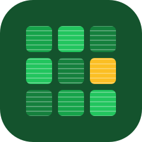
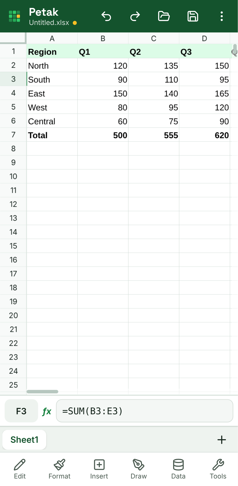
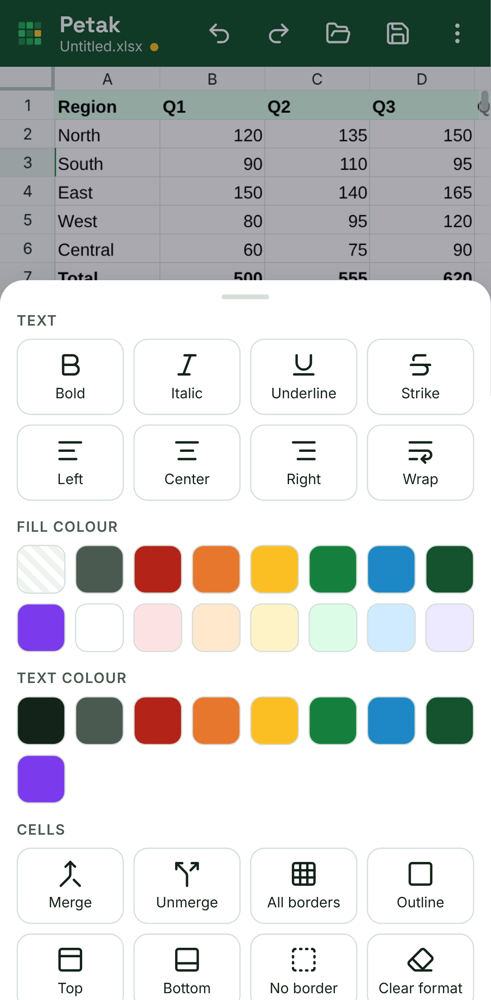
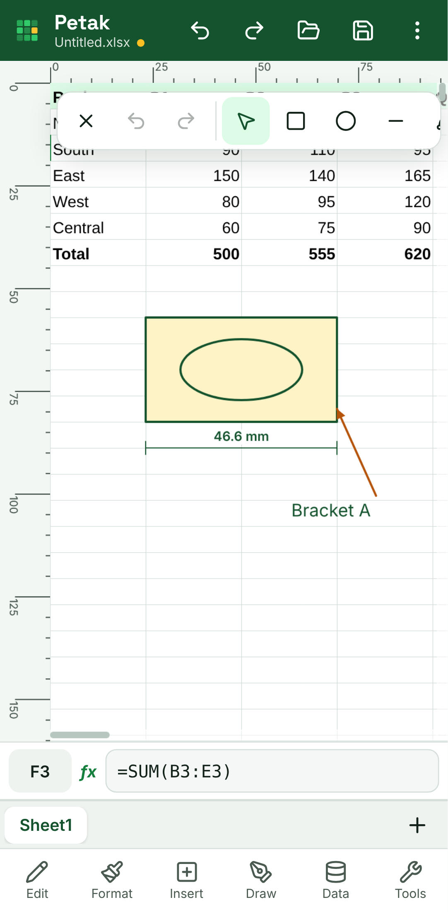
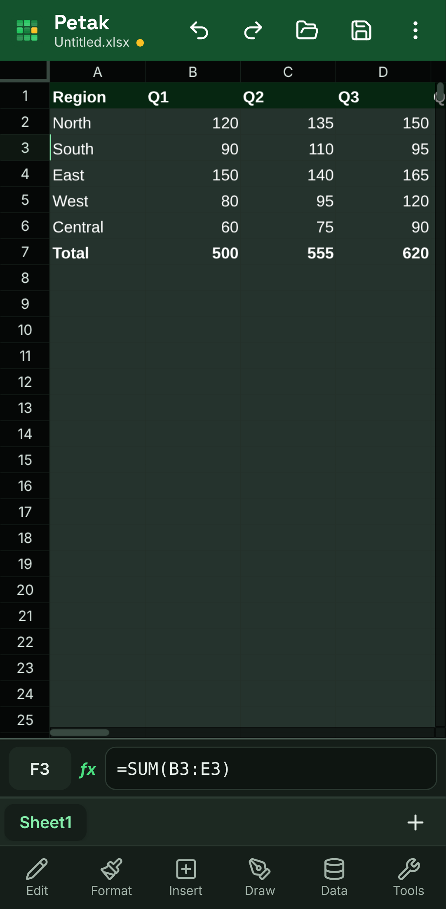
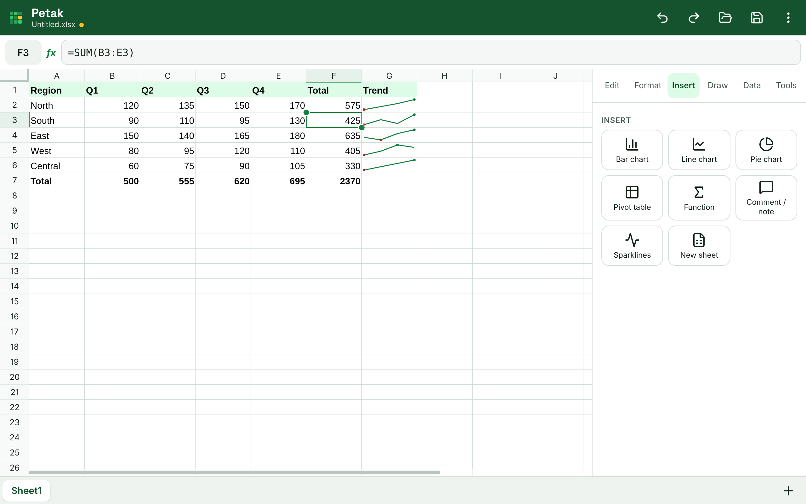
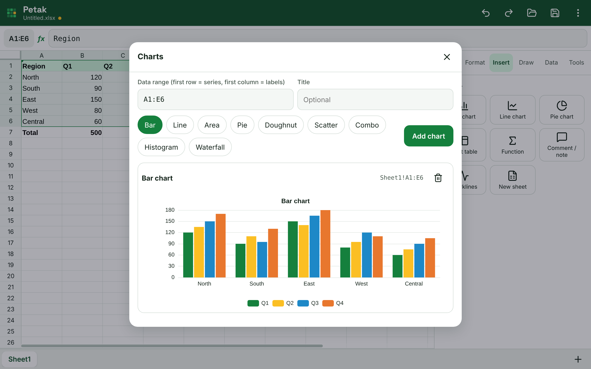

<p align="center"></p>

# Petak

**An open-source spreadsheet app for Android phones and tablets.**
Open, edit and save `.xlsx`, `.xlsm` and `.csv` files from your phone storage, with 476 Excel functions, charts,
pivot tables, comments, data validation, sparklines, what-if analysis, slicers, a DuckDB data model,
a precision drawing layer with true-scale export, JavaScript macros and a Power-Query-style transform panel, all on the device.

License: **GNU GPL v3** (see [LICENSE](LICENSE)). Third-party components: [THIRD_PARTY_LICENSES.md](THIRD_PARTY_LICENSES.md).

> **Download:** the latest APK is on the [Releases page](https://github.com/aiman-959/petak/releases/latest)
> (`Petak-v1.1.0.apk`, 3.9 MB). See [Install](#install).

| Phone | Format tools | Drawing mode | Dark mode |
|---|---|---|---|
|  |  |  |  |

| Tablet with side panel | Charts |
|---|---|
|  |  |

Screenshots come from the production web build at phone/tablet sizes (`node scripts/screenshots.mjs`).

---

## Features

| # | Feature | Notes |
|---|---|---|
| 1 | **Open / edit / save** `.xlsx`, `.xlsm`, `.csv` (also opens `.xls`, `.ods`) | Android Storage Access Framework picker (Downloads, Drive, SD card…). **Save** writes back to the same file, **Save as** creates a new one. "Open with Petak" from file managers. |
| 2 | **Formulas**: 476 of 514 Excel 365 functions | HyperFormula plus ~90 functions added by Petak (TEXTSPLIT, TAKE, DROP, CHOOSECOLS, VSTACK, LET-style helpers, financial, statistical, engineering…). Incremental recalculation in a worker. Full list and the 38 that cannot work on a phone: [FUNCTIONS.md](FUNCTIONS.md). |
| 3 | **Sheets, freeze panes, sort, filter, find & replace** | Full Excel grid size (1,048,576 × 16,384), grows as you scroll. |
| 4 | **Formatting** | Number formats, fonts, colours, borders, alignment, merge, conditional formatting. Saved to xlsx. |
| 5 | **Charts** | Bar, line, area, pie, doughnut, scatter, combo (bar + line, second axis when needed), histogram, waterfall. Live, stored in the file. |
| 6 | **Pivot tables and slicers** | Row × column fields, sum/count/average/min/max. Slicers filter tables and pivots by tapping values. |
| 7 | **Comments and notes** | Threaded comments with replies and resolve; classic notes. Notes and comments round-trip through xlsx. |
| 8 | **Data validation** | Lists (typed or from a range), whole/decimal numbers, dates, text length, custom formulas; input messages and Stop / Warning / Information alerts. Saved to xlsx. |
| 9 | **Sparklines** | Line, column and win/loss charts inside cells, one per row or column. |
| 10 | **What-if analysis** | Goal Seek, Scenario Manager (save, show, summary) and one- / two-variable Data Tables. |
| 11 | **Data model** | Relationships between tables, cross-table pivots and SQL queries on **DuckDB-WASM**, downloaded only when first used (6.6 MB, size shown first, removable). |
| 12 | **Import from URL** | CSV or JSON from a web address as a transform source, with **Refresh**. |
| 13 | **Drawing and precision tools** | Rectangle, ellipse, line, polyline, arrow, text box, image and dimension line, drawn on the sheet. Snapping (cell edges/corners, cell centres, objects' edges/midpoints/centres, ruler grid, 15° angles, each switchable), rulers in mm / cm / in / px / cells, exact X/Y/W/H/rotation input, live dimensions, smart guides, align and distribute, layers (show/hide/lock), groups, magnifier loupe, column widths / row heights in mm, export to **SVG, DXF and PDF at true scale (1:1)**. |
| 14 | **Undo / redo and autosave** | Session autosaves to app storage and is restored at next launch. Drawings have their own undo history. |
| 15 | **Macros** | JavaScript macros in a sandboxed worker. **VBA in `.xlsm` files is preserved on save but not executed.** |
| 16 | **Data transforms** (Power Query-like) | CSV / xlsx / sheet range / URL sources; filter, remove columns, change type, merge, group by, pivot, unpivot, sort, rename, SQL (with the data model). Refreshable. |

### Design
* Original look: deep green **#14532D** header, primary green **#15803D**, gold accent **#FBBF24**; all text
  colour pairs pass WCAG AA (checked by `tests/unit/contrast.test.ts`). Wordmark in Space Grotesk Bold.
* **Phone:** bottom toolbar (Edit · Format · Insert · Draw · Data · Tools) opening bottom sheets; formula bar
  docked at the bottom above the keyboard. **Tablet (≥ 760 dp):** formula bar on top and a side panel.
* Touch targets ≥ 44 dp, pinch-to-zoom, light and dark mode.

### Performance and device support
* Android **8.0+** (minSdk 26), target SDK 36, **arm64-v8a, armeabi-v7a, x86_64**. Tuned on a Snapdragon 8s Gen 3;
  Low and Mid tiers are tested in CI-style e2e runs (`?tier=low|mid`).
* **Tiers** from RAM and core count (native `DeviceInfo` plugin):

  | Tier | RAM | Load chunk | Workers | Display |
  |---|---|---|---|---|
  | Low | ≤ 3 GB | 1,000 rows | 1 | reduced motion, grid canvas ≤ 1.5x |
  | Mid | 4–6 GB | 4,000 rows | 2 | grid canvas ≤ 2x |
  | High | 8 GB+ | 10,000 rows | up to 4 | native resolution, **90/120 Hz** requested |

* **Canvas rendering, no DOM cells.** The grid, sparklines and drawings are painted on Univer's canvas (GPU-composited
  by the WebView); only visible cells are drawn. Scrolling and zooming move the canvas, not thousands of elements.
* **Workers for everything heavy:** formulas (HyperFormula), file parsing/writing, transforms, macros, DuckDB.
* **SharedArrayBuffer when available, with a fallback.** The app serves COOP/COEP headers (Vite and the Android
  WebView client). When the page is cross-origin isolated, the UI and workers share a control block: workers read the
  load level with `Atomics` mid-loop and pause with `Atomics.wait`. Otherwise the same level is sent as messages.
  About → *Live performance* shows which mode is active.
* **Thermal and frame-time governor.** While you interact, frame times are sampled. If over 25 % of frames are dropped,
  or Android reports MODERATE thermal status or battery saver, background work (autosave, sparkline repaints, chunked
  loading) is spaced out and animations stop. At SEVERE or worse, chunk pauses grow and the High tier leaves 120 Hz until
  the phone cools down.
* Incremental autosave (changed 2,000-row chunks only), incremental recalculation, chunked loading with progress.
* 50,000 × 20 performance test: [tests/perf/RESULTS.md](tests/perf/RESULTS.md).

### App size
Release APK **3.9 MB** (budget 40 MB). Full breakdown per build and module: [SIZE.md](SIZE.md) (`npm run size`).
* Heavy optional engines download on first use with their size shown first: DuckDB (6.6 MB download, 35.7 MB on device).
* Unused Univer hyphenation dictionaries for 77 languages removed at build time; English-only Android resources;
  R8 code and resource shrinking; one font file (Space Grotesk Bold, Latin, 13 kB); minified, tree-shaken, code-split JS.
* Per-ABI APKs are built alongside the universal APK. They are the same size because Petak has no native code.

---

## Install

1. On your phone, open the [latest release](https://github.com/aiman-959/petak/releases/latest) and download
   `Petak-v1.1.0.apk` (universal). ABI-specific files (`-arm64-v8a`, `-armeabi-v7a`, `-x86_64`) are also there.
2. Open it and allow "Install unknown apps" for your browser or file manager when Android asks.
3. Launch **Petak** and tap the folder icon to open a spreadsheet.

Check the download against `SHA256SUMS.txt` from the same release if you like. Release APKs built without the
repository's signing secrets are signed with the CI debug key. If you later install a build signed with a different
key, uninstall the old app first (Android refuses updates signed by another key).

---

## Build from source

### Requirements
* Node.js 20+ (22 recommended) and npm
* JDK 21
* Android SDK with platform 36 and build-tools 35+ (Android Studio, or the command line tools below)

```bash
# Android SDK without Android Studio (Linux/macOS)
export ANDROID_HOME=$HOME/android-sdk
mkdir -p $ANDROID_HOME/cmdline-tools && cd $ANDROID_HOME/cmdline-tools
curl -LO https://dl.google.com/android/repository/commandlinetools-linux-14742923_latest.zip
unzip commandlinetools-linux-*_latest.zip && mv cmdline-tools latest
yes | latest/bin/sdkmanager --licenses
latest/bin/sdkmanager "platform-tools" "platforms;android-36" "build-tools;36.0.0"
```

### Debug APK

```bash
git clone https://github.com/aiman-959/petak.git && cd petak
npm ci
npm run build                 # type-check + minified, code-split web build into dist/
npx cap sync android          # copy dist/ into the Android project
cd android
echo "sdk.dir=$ANDROID_HOME" > local.properties
./gradlew assembleDebug
# -> android/app/build/outputs/apk/debug/app-universal-debug.apk (+ one APK per ABI)
adb install -r app/build/outputs/apk/debug/app-universal-debug.apk   # optional, phone connected with USB debugging
```

### Release APK (signed)

```bash
# 1. one-time: create your signing key (keep it safe and never commit it)
keytool -genkeypair -v -keystore ~/petak-release.jks -alias petak \
        -keyalg RSA -keysize 4096 -validity 10000

# 2. tell Gradle where it is (android/keystore.properties is git-ignored)
cat > android/keystore.properties <<'EOF'
storeFile=/home/you/petak-release.jks
storePassword=YOUR_STORE_PASSWORD
keyAlias=petak
keyPassword=YOUR_KEY_PASSWORD
EOF

# 3. build
npm ci && npm run build && npx cap sync android
cd android && ./gradlew assembleRelease
# -> android/app/build/outputs/apk/release/app-universal-release.apk  (R8-minified, resources shrunk, signed)
# Google Play wants an App Bundle instead:  ./gradlew bundleRelease
```

Instead of `keystore.properties` you can set the environment variables `PETAK_KEYSTORE`,
`PETAK_KEYSTORE_PASSWORD`, `PETAK_KEY_ALIAS` and `PETAK_KEY_PASSWORD`.
Without either, `assembleRelease` signs with the debug key so the APK can still be installed for testing.

### Continuous integration
`.github/workflows/android.yml` runs the unit tests and builds debug and release APKs (universal + per ABI) on every push,
with the size report in the job summary. Pushing a tag such as `v1.1.0` creates a GitHub Release with the APKs,
`SHA256SUMS.txt` and `SIZE.md` attached. Add the repository secrets
`KEYSTORE_BASE64` (`base64 -w0 petak-release.jks`), `KEYSTORE_PASSWORD`, `KEY_ALIAS` and `KEY_PASSWORD`
to get a signed release APK.

### Develop in the browser

```bash
npm run dev            # http://localhost:5173  (?mobile, ?desktop, ?tier=low|mid|high, ?fresh)
npm test               # 93 unit tests (formulas, functions, xlsx round trip, drawing geometry/export, governor…)
npm run build && npm run preview &                  # serve the production build on :4173
export BASE_URL=http://localhost:4173/
npm run test:e2e                   # core features (19 checks)
node tests/e2e/part2.mjs           # comments, validation, sparklines, what-if, slicers, data model, URL import (16)
node tests/e2e/part3.mjs           # drawing and precision tools (17)
node tests/e2e/part4.mjs           # shared memory / fallback, governor, Low and Mid tiers (9)
npm run test:perf                  # 50k x 20 load / scroll / memory test -> tests/perf/RESULTS.md
npm run size                       # size report -> SIZE.md
```
Playwright needs a Chromium: `npx playwright install chromium`, or point `CHROMIUM_PATH` at an existing one.

---

## Project layout

```
src/
  univer/        Univer grid setup (desktop + mobile plugins), conditional-format mapping
  engine/        HyperFormula worker, formula bridge (incremental recalc), RPC helper
  io/            xlsx read/write (ExcelJS), csv/xls/ods (SheetJS), VBA preservation, file access
  device/        tiers, load governor (frame time / thermal), shared-memory control, native plugin wrappers
  draw/          drawing layer: geometry & snapping, renderer, overlay UI, SVG/DXF/PDF exporters
  review/        comments, notes, data validation
  features/      sparklines, what-if, slicers
  datamodel/ modules/   DuckDB data model and the on-demand module downloader
  state/         document controller (open/save/autosave), IndexedDB storage
  ui/            app chrome, toolbars, dialogs (touch-first)
  charts/ pivot/ macros/ transform/   feature panels (lazy-loaded) and their workers
android/app/src/main/java/com/zetl/petak/
  MainActivity.java (COOP/COEP headers), DeviceInfoPlugin.java (RAM/cores/SoC/refresh rate/thermal), DocumentsPlugin.java (SAF)
tests/unit  tests/e2e  tests/perf
```

## How it compares to desktop Excel
Petak is **not a clone of Microsoft Excel**. It is an independent, original app that opens and saves the same
file formats and covers everyday spreadsheet work on a phone. It does not copy Excel's look or branding.

| | Petak 1.1 | Desktop Excel |
|---|---|---|
| Grid size | 1,048,576 rows × 16,384 columns (A…XFD) | same |
| Functions | 476 of 514 (92.6 %), list in [FUNCTIONS.md](FUNCTIONS.md) | 514 |
| Charts | bar, line, area, pie, doughnut, scatter, combo, histogram, waterfall, sparklines | 20+ types incl. 3D, maps, stock, funnel |
| Comments / notes, data validation | ✓ (round-trip through xlsx) | ✓ |
| What-if | Goal Seek, Scenario Manager, Data Tables | same + Solver add-in |
| Slicers | for tables and pivots (stored in Petak metadata) | ✓ native |
| Data model | DuckDB (download on demand): relationships, cross-table pivots, SQL | Power Pivot (DAX) |
| External data | CSV/JSON from a URL, refreshable | Power Query connectors, ODBC, OLAP |
| Drawing | shapes, images, dimensions, snapping, rulers in mm, layers, true-scale SVG/DXF/PDF | shapes, SmartArt (no CAD-style precision tools) |
| Macros | JavaScript (sandboxed); VBA kept in .xlsm but not run | VBA, Office Scripts |
| Co-authoring | — (not planned for now) | ✓ |

## Known limitations
* VBA macros are kept but never executed. JavaScript macros cover the automation use case.
* Charts, pivots, slicers, sparklines, scenarios, drawings and transform queries are stored in a hidden worksheet
  (`__petak_meta`). Other apps keep them but do not show them as their own objects. Comments, notes and data
  validation are written as real xlsx objects.
* Drawings are Petak shapes, not xlsx drawing objects; export them as SVG/DXF/PDF to use elsewhere.
* The drawing overlay assumes no frozen panes while drawing; with frozen panes, shapes still render correctly but pointer
  positions refer to the scrolling area.
* Whether the Android WebView honours COOP/COEP (and so enables SharedArrayBuffer) depends on the WebView version;
  when it does not, the message fallback is used. About → *Live performance* shows the mode on your phone.
* Very large files (500k+ cells on Low tier) can exceed WebView memory. The app warns before opening files over 100k rows on Low and Mid tiers.

## Contributing
Issues and pull requests are welcome. By contributing you agree your work is licensed under GPL-3.0.

## License
Petak is free software: you can redistribute it and/or modify it under the terms of the GNU General
Public License version 3 as published by the Free Software Foundation. It is distributed WITHOUT ANY WARRANTY.
See [LICENSE](LICENSE).
